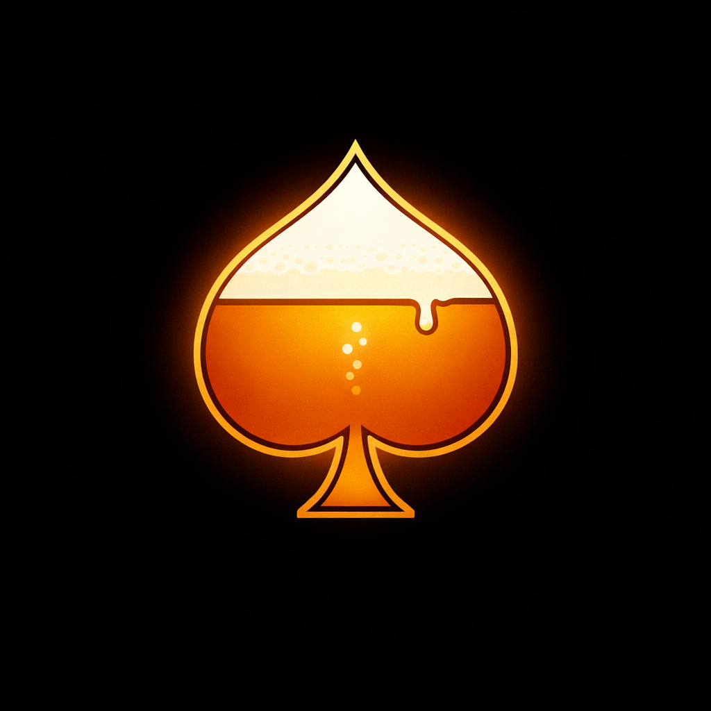

#  Black(Out)Jack: Normal Mode

Standard blackjack against the house, played for money instead of sips. Only the differences are listed here.

## Money

| | |
|---|---|
| Bankroll | Everyone starts with **$100** |
| Stake | A fixed amount per hand (default **$10**, adjustable in steps of **$2.50**) |
| Stake window | After **Deal**, you have **15 seconds** to change your stake or accept it. Bots keep theirs |
| Win | Pays **1:1** |
| Blackjack | Pays **3:2** |
| Push | Stake returned |
| Loss | Stake lost |
| Bankroll too low | Re-buy at the ATM for a fresh $100 |

## Table rules

- The dealer is the house and draws until **17** (stands on all 17s, soft ones included).
- **Double**: any two-card hand, one card only, stake doubles. Allowed after a split.
- **Split**: costs another stake. Up to **5 hands** per starting hand.
- **Split aces**: one card each, then both hands stand.

## Bust side bet

Before the dealer plays, you can bet on whether the dealer will bust. A correct call pays **2:1**, a wrong call loses the side stake. The side stake is half your hand stake by default.

## Buy-in handouts (optional)

The host can switch on **Buy-in Handouts** in Settings. At the end of each round, everyone whose bankroll is above the starting **$100** gets to hand out a sip to another player (or pass). Bots hand theirs out automatically. Unclaimed handouts lapse when the next round starts.

## Switching modes

The host can switch a Normal table to Drinking in Settings at any time. The change applies from the next round: same players and seats, no lobby, nobody re-enters a name. It is one-way: a Drinking table can't go back to Normal.

Any seated player can also start a **table vote** (the 🍻 button in the header):

- **Most players say yes**: the whole table switches to Drinking from the next round.
- **Not enough say yes**: the table stays Normal, and only the players who said yes move to a new Drinking table. They get a few seconds to **Cancel** before being moved, and keep their name, with no lobby.

## Tracking

The **Round** tab shows everyone's bankroll, last-round result and best and worst round.

---

## 🍻 Want it a bit more exciting?

Playing with friends? Black(Out)Jack also comes as a **drinking game**: sips instead of money, rotating dealers, side bets, dealer lottery, targeted drinking and more. Start a new table in **Drinking Mode** to try it.

Please drink responsibly.
